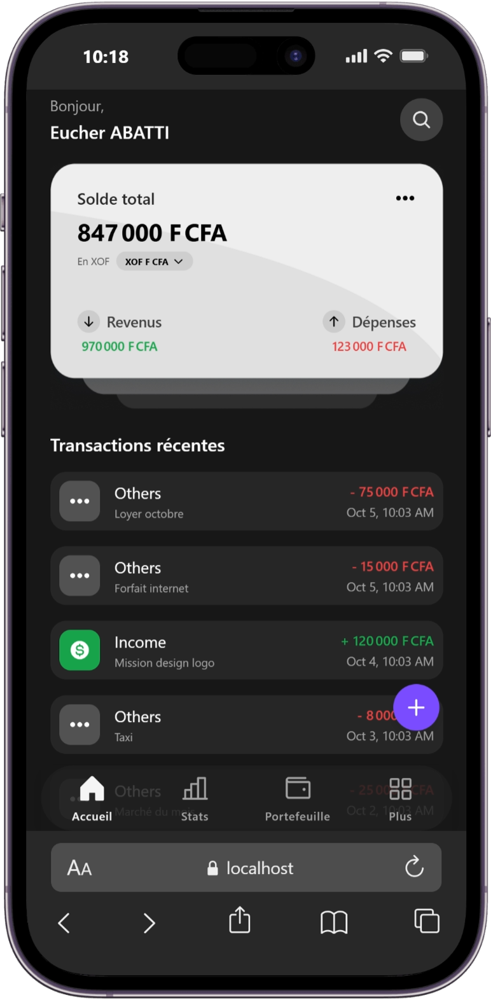

<a name="readme-top"></a>

<p align="center">
  
</p>

<p align="center">
  <h3 align="center">Akouè App</h3>
  <p align="center">
    Maîtrise ton argent. Note. Contrôle.
    <br />
    App open source de gestion financière personnelle
    <br />
    <br />
    <a href="https://github.com/T0b0i7/akoue-app"><strong>Code »</strong></a>
    &middot;
    <a href="https://github.com/T0b0i7/akoue-app/issues">Issues</a>
    &middot;
    <a href="https://github.com/T0b0i7/akoue-app/issues/new?labels=enhancement&template=FEATURE_REQUEST_TEMPLATE.md">Demander une fonctionnalité</a>
  </p>
</p>

<p align="center">
  <a href="https://github.com/T0b0i7/akoue-app/blob/main/LICENSE">
    
  </a>
  <a href="https://github.com/T0b0i7/akoue-app/stargazers">
    
  </a>
  <a href="https://github.com/T0b0i7/akoue-app/forks">
    
  </a>
  <a href="https://www.typescriptlang.org/">
    
  </a>
  <a href="https://github.com/T0b0i7/akoue-app/commits/main">
    
  </a>
  <a href="https://github.com/T0b0i7/akoue-app/pulls">
    
  </a>
</p>

<details>
<summary>Table des matières</summary>

- [À propos](#à-propos-dakouè)
- [Nouveautés](#-akouè-évolue)
- [Captures](#-captures-décran)
- [Fonctionnalités](#-fonctionnalités)
- [Technologies](#-technologies)
- [Démarrage](#-installation-et-démarrage)
- [Tableau de bord admin](#admin-dashboard)
- [Contribuer](#-contribuer)
- [Licence](#-licence)
- [Remerciements](#-remerciements)

</details>

## À propos d’Akouè

**Akouè** est une application de gestion financière personnelle conçue et maintenue par [[redacted-name]](https://github.com/T0b0i7). Organise tes portefeuilles, suis tes revenus et tes dépenses, et comprends mieux tes habitudes financières.

Le projet utilise **Expo 54, React Native 0.81 et Supabase**. Le dépôt est public et distribué sous licence MIT.

> **Une étoile avant de commencer ?** Si Akouè te plaît, [ajoute une étoile au dépôt](https://github.com/T0b0i7/akoue-app/stargazers) pour soutenir le projet et le faire découvrir. Cette étoile est volontaire : GitHub ne permet pas de l’imposer ni de bloquer techniquement l’exécution du code en son absence.

## 📣 Akouè évolue

Akouè est conçue pour aider chacun à reprendre simplement le contrôle de son argent. L’application réunit au même endroit les portefeuilles, les revenus, les dépenses et les justificatifs, pour que le suivi du quotidien soit plus clair et plus pratique.

Les dernières évolutions mettent l’accent sur une utilisation plus fluide et une meilleure protection des données personnelles. Tu peux choisir un verrouillage adapté à ton appareil, continuer à consulter et saisir tes opérations hors connexion, puis synchroniser les données lorsque le réseau revient. Les statistiques et les soldes multi-devises aident à mieux comprendre l’activité, tandis que les annonces intégrées préviennent des nouveautés et des mises à jour disponibles.

### Ce que tu peux faire avec Akouè

- Organiser ton argent dans plusieurs portefeuilles.
- Enregistrer tes revenus et dépenses avec catégories, dates, notes et justificatifs.
- Explorer tes habitudes grâce aux statistiques et aux graphiques.
- Protéger l’accès à l’application avec la biométrie, un code PIN, un mot de passe ou un schéma, selon les options disponibles sur l’appareil.
- Continuer à utiliser les fonctions prévues hors connexion et synchroniser plus tard.
- Afficher les soldes dans une devise de ton choix parmi celles prises en charge.
- Recevoir les annonces et informations de mise à jour directement dans l’application.

Akouè continue d’évoluer. Les contributions, retours d’expérience et signalements de bugs sont les bienvenus.

## 📥 Télécharger

Dernier APK Android (preview) : **[akoue-app preview (.apk)](https://expo.dev/artifacts/eas/izERwe5ZsIhZ8Es70U5HxUJwU5lSjJrmKoo8PLHOUIU.apk)**
Installe-le direct sur ton téléphone pour tester (autorise l'installation depuis cette source).

Version web installable (PWA) : **[akoue-app sur le web](https://akoue-app--vtjbp6hmzm.expo.app)** — ouvrable dans Chrome Android puis "Ajouter à l'écran d'accueil" pour l'installer comme une app, utilisable hors ligne.

## 📷 Captures d’écran

<p align="center">
  
</p>

| | | | |
|---|---|---|---|
|  |  |  |  |

## 🔥 Fonctionnalités

- **💰 Multi-Wallet Management**
  Crée et gère plusieurs portefeuilles pour organiser tes finances.

- **📊 Visual Analytics**
  Graphiques hebdo/mensuels/annuels pour visualiser revenus vs dépenses.

- **📝 Smart Transaction Tracking**
  Ajoute revenus/dépenses avec catégories, dates et notes.

- **🧾 Reçus et justificatifs**
  Attache tes reçus (stockage Supabase privé) — ne perds plus une facture.

- **🔍 Recherche avancée**
  Recherche par mot-clé, catégorie ou type de transaction.

- **🔐 Verrouillage de l'app**
  Biométrie (visage/empreinte), PIN, mot de passe ou schéma glissé au doigt. Anti force brute (pause 30s après 5 échecs), code oublié réinitialisable via ton mot de passe compte.

- **📴 Offline first**
  Tout marche sans connexion (cache local + file de synchro), les données remontent quand le réseau revient.

- **💱 Multi-devises**
  XOF, EUR, USD… solde total converti en temps réel dans ta devise d'affichage.

- **🔄 Mises à jour intégrées**
  OTA silencieux + téléchargement direct des nouvelles versions dans l'app, annonces ciblées par version.

- **👤 Auth Supabase**
  Inscription/connexion avec vérification email (écran dédié + renvoi), mot de passe oublié, mode hors ligne.

- **🎨 Smooth UI/UX**
  Tab bar custom, animations Reanimated, design responsive.

## ✨ Technologies

<details><summary><b>Akouè App</b> est construit avec :</summary>

- [TypeScript](https://www.typescriptlang.org/)
- [React Native](https://reactnative.dev/) 0.81
- [Expo](https://expo.dev/) 54 + [Expo Router](https://docs.expo.dev/router/introduction/)
- [Supabase](https://supabase.com/) + [Firebase](https://firebase.google.com/)
- [Reanimated](https://docs.swmansion.com/react-native-reanimated/)
- [Zod](https://zod.dev/)
- [Gifted Charts](https://github.com/Abhinandan-Kushwaha/react-native-gifted-charts) + [Flash List](https://shopify.github.io/flash-list/)
- [Phosphor Icons](https://phosphoricons.com/)

</details><br/>

[](https://github.com/T0b0i7/akoue-app)

## 🧰 Installation et démarrage

 1. Prérequis : [Git](https://git-scm.com/downloads), [Node.js](https://nodejs.org/) 20 ou plus, et [pnpm](https://pnpm.io/installation) (`npm install --global pnpm`).
 2. Clone ton fork :

    ```bash
    git clone https://github.com/T0b0i7/akoue-app.git
    cd akoue-app
    ```
 3. Installe les dépendances :

    ```bash
    pnpm install
    ```
 4. Configure tes services : copie `.env.example` vers `.env`, puis renseigne les variables Supabase nécessaires. Les variables Firebase sont facultatives si tu n’utilises pas ces fonctions.

    ```bash
    cp .env.example .env
    ```
    N’utilise jamais de clé `service_role` ou de secret serveur dans une variable `EXPO_PUBLIC_*`. Ces variables sont intégrées au client public.
 5. **Démarre le projet avant de l’utiliser ou de le modifier** :

    ```bash
    pnpm start
    ```

    Pour lancer une cible précise, utilise ensuite `pnpm android`, `pnpm ios` ou `pnpm web`.
 6. Configure ta base de données Supabase : exécute [`supabase/schema.sql`](./supabase/schema.sql) dans le SQL Editor de ton projet. Ce schéma met en place les tables et politiques nécessaires à l’application.
 7. Vérifications du projet :
     ```bash
     pnpm lint
     pnpm test:unit
     node scripts/check-attribution.js
     ```
 8. (Optionnel) Builds et mises à jour Android :
     ```bash
     pnpm build:android                         # build de prévisualisation
     pnpm update:android:preview                 # mise à jour OTA du canal preview
     pnpm update:android:production              # mise à jour OTA du canal production
     ```

    Une mise à jour OTA ne convient qu’aux changements compatibles avec le runtime natif déjà installé. Les changements natifs nécessitent un nouveau build. Les publications EAS nécessitent une configuration de compte et un jeton Expo.
 9. (Optionnel) Compte démo avec données fictives :
     ```bash
     node scripts/seed-demo.js
     ```

<a id="admin-dashboard"></a>

## 🛠️ Tableau de bord d’administration

Le tableau de bord web statique est dans [`admin-web/`](./admin-web/). Consulte [`admin-web/README.md`](./admin-web/README.md) pour la configuration Supabase et son utilisation. Il nécessite son propre compte Supabase et les règles d’accès administrateur décrites dans la documentation.

## 🔧 Contribuer

Les contributions sont les bienvenues. Avant d’ouvrir une Pull Request :

1. Consulte [`CONTRIBUTING.md`](./CONTRIBUTING.md) et crée un fork.
2. Crée une branche dédiée (`git checkout -b feat/ma-feature`).
3. Démarre le projet avec `pnpm start` et vérifie tes changements.
4. Lance `pnpm lint` et `pnpm test:unit`.
5. Fais un commit clair, pousse ta branche et ouvre une Pull Request vers `main`.

Ne publie jamais de fichier `.env`, de mot de passe, de clé privée ou de jeton. Les fichiers d’environnement locaux sont ignorés par Git ; vérifie toujours le contenu de ta Pull Request avant de la soumettre.

## 📄 Licence

Distribué sous licence **MIT**. La licence exige que l’avis de copyright et le texte de licence soient conservés dans les copies ou portions substantielles du logiciel. Voir [`LICENSE`](./LICENSE).

**Copyright (c) 2026 Akouè — Créé par [redacted-name]**

Le dépôt public et la licence ne peuvent pas empêcher techniquement la modification d’un fork. L’avis de copyright est protégé par les conditions de la licence MIT ; le contrôle automatique du dépôt vérifie aussi sa présence dans les fichiers principaux. Pour refuser une modification de `main`, configure les règles de protection de branche GitHub et rends le contrôle d’attribution obligatoire.

## 💎 Remerciements

- [Expo](https://expo.dev/) • [React Native](https://reactnative.dev/) • [Supabase](https://supabase.com/)
- [Expo Router](https://docs.expo.dev/router/introduction/) • [Reanimated](https://docs.swmansion.com/react-native-reanimated/) • [Gifted Charts](https://github.com/Abhinandan-Kushwaha/react-native-gifted-charts) • [Phosphor Icons](https://phosphoricons.com/) • [Flash List](https://shopify.github.io/flash-list/) • [Zod](https://zod.dev/)

## ⭐ Soutenir Akouè

Si Akouè t'aide, laisse une ⭐ — ça aide le projet à être découvert !

## 🌟 Star History

<a href="https://star-history.com/#T0b0i7/akoue-app&Timeline">
<picture>
  <source media="(prefers-color-scheme: dark)" srcset="https://api.star-history.com/svg?repos=T0b0i7/akoue-app&type=Timeline&theme=dark" />
  <source media="(prefers-color-scheme: light)" srcset="https://api.star-history.com/svg?repos=T0b0i7/akoue-app&type=Timeline" />
  
</picture>
</a>

<br />
<p align="right">(<a href="#readme-top">back to top</a>)</p>
